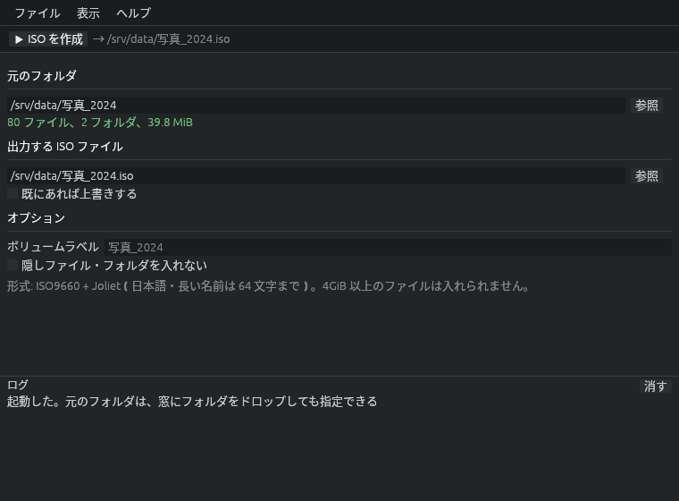

# folder2iso

**folder2iso** は、フォルダを 1 つ選ぶだけで、その中身をまるごと入れた **ISO イメージファイル（.iso）** を作るツールです。
Windows と Linux で動き、画面（GUI）とコマンドライン（CLI）のどちらでも使えます。
画面の見た目とフォルダを選ぶ窓は、[vw](https://github.com/xex-ken-xex/vw) と同じ部品（`vw-ui`・`vw-tree`）を使っています。

ISO の作り方は OS で変わります。

| OS | 作り方 | 形式 | 4GiB 以上のファイル |
| --- | --- | --- | --- |
| **Windows** | 同じフォルダの [`folder2DVD_ISO.ps1`](tools/README.md) を呼び、Windows 標準の **IMAPI2** に作らせる | ISO9660 + Joliet + UDF | **入れられる**（自動で UDF だけにする） |
| Linux | folder2iso 自身が書き出す | ISO9660 + Joliet | 入れられない |

> **Windows では `folder2iso.exe` と `folder2DVD_ISO.ps1` を必ず同じフォルダに置いてください。** ps1 がないと ISO を作れません（画面にもそう出ます）。



---

## 目次

- [できること](#できること)
- [できないこと（制限）](#できないこと制限)
- [前提条件](#前提条件)
- [入手する](#入手する)
- [使い方: 画面（GUI）](#使い方-画面gui)
- [使い方: コマンドライン（CLI）](#使い方-コマンドラインcli)
- [ファイル名の扱い](#ファイル名の扱い)
- [作った ISO を使う](#作った-iso-を使う)
- [困ったとき](#困ったとき)
- [開発とビルド](#開発とビルド)
- [技術メモ](#技術メモ)
- [ライセンス](#ライセンス)

---

## できること

| | 内容 |
| --- | --- |
| 📁 → 💿 | 指定したフォルダの中身（サブフォルダも含めて全部）を 1 つの `.iso` ファイルにまとめる |
| 📀 | 焼く予定のメディア（CD / DVD / 2 層 DVD / BD / 2 層 BD）を選ぶと、入りきらないときは作る前に止める。既定は「上限なし」 |
| 🇯🇵 | **日本語のファイル名・フォルダ名をそのまま入れられる**（Joliet 形式。1 つの名前は 64 文字まで） |
| 🪟 | Windows のエクスプローラで **ダブルクリックするだけで開ける（マウントできる）** ISO を作る。Linux・macOS でも読める |
| 🏷️ | ボリュームラベル（ドライブ名の横に出る名前）を付けられる。空ならフォルダ名 |
| 🙈 | 隠しファイル・隠しフォルダを入れないこともできる |
| ⏱️ | 進み具合（％・速さ・残り時間）を出し、途中で **中断** できる。中断したら書きかけのファイルは消す |
| 🛡️ | 既にあるファイルは、明示しない限り **上書きしない**。出力先を元のフォルダの中にする間違いも止める |
| 🖱️ | 画面に **フォルダをドラッグ＆ドロップ** して指定できる |
| ⌨️ | コマンドラインでも使えるので、バッチファイルやスクリプトから自動で作れる |

## できないこと（制限）

- **Linux では 4GiB 以上のファイルは入れられません。** ISO9660 / Joliet の 1 ファイルの上限が 4GiB − 1 バイトのためです。
  入れようとすると、どのファイルが大きすぎるかを示して止まります（作り始める前に、画面でも警告します）。
  Windows では IMAPI2 が UDF で作るので入れられます。
- **起動できる（ブータブル）ISO は作れません**（El Torito 非対応）。データを入れるための ISO です。
- **シンボリックリンク・ジャンクションは入れません**（飛ばしてログに出します）。リンク先をたどるとループして終わらないことがあるためです。
- Joliet の名前は 1 つ 64 文字までです。長い名前は、拡張子を残して末尾を切ります（ログに「名前を変えて入れた」と出ます）。
- ファイルの属性（読み取り専用・隠しなど）やアクセス権は入りません。更新日時は入ります。

## 前提条件

### 使うだけなら

| 項目 | 内容 |
| --- | --- |
| OS | Windows 10 / 11（64bit）、または Linux（x86_64。X11 か Wayland のデスクトップ） |
| 描画 | OpenGL 2.0 以上、または DirectX 12（Windows）。ふつうの PC なら満たしています。OpenGL がない仮想マシンでも、自動で DirectX 12 のソフトウェア描画に切り替えて起動します |
| 日本語表示 | Windows は標準で入っている游ゴシック・メイリオ・MS ゴシックのどれかを自動で使います。Linux は Noto Sans CJK・IPAex ゴシックなどの日本語フォントが要ります（例: `sudo apt install fonts-noto-cjk`） |
| 空き容量 | 出力先のドライブに、元のフォルダと同じくらいの空き |
| 管理者権限 | **不要** |
| Windows で要るもの | `folder2DVD_ISO.ps1` を exe と同じフォルダに置くこと。Windows PowerShell 5.1 と IMAPI2 は Windows に標準で入っています |

コマンドライン（CLI）だけを使うなら、描画と日本語フォントの条件は要りません。

Windows では、exe が `powershell.exe -NoProfile -NonInteractive -ExecutionPolicy Bypass -File folder2DVD_ISO.ps1 ...` を窓を出さずに起動します。
`-ExecutionPolicy Bypass` はこの 1 回の実行だけに効き、PC の実行ポリシーの設定は変えません。

### 自分でビルドするなら

| 項目 | 内容 |
| --- | --- |
| Rust | stable の最新版（[rustup](https://rustup.rs/) で入れる） |
| Git | 依存している vw の部品を GitHub から取ってくるのに使います |
| ネット接続 | 初回のビルドで crates.io と GitHub（vw）から依存を落とします |
| Windows | 追加のツールは不要（Rust のインストーラが案内する Visual Studio Build Tools があれば OK） |

## 入手する

### A. ビルド済みの実行ファイルを使う

GitHub の [Actions](https://github.com/xex-ken-xex/folder2iso/actions) の最新の成功した実行を開き、
下の **Artifacts** から `folder2iso-windows-x64` を落として展開すると、`folder2iso.exe` と `folder2DVD_ISO.ps1` が入っています。
インストールは要りません。**2 つを同じフォルダのまま**、好きな場所に置いて使ってください。

### B. ソースからビルドする

```powershell
git clone https://github.com/xex-ken-xex/folder2iso.git
cd folder2iso
cargo build --release
# できあがり: target\release\folder2iso.exe（Linux は target/release/folder2iso）
# Windows では tools\folder2DVD_ISO.ps1 を exe の隣に写す
copy tools\folder2DVD_ISO.ps1 target\release\
```

`cargo run` で動かすときは、exe の隣に ps1 がなくてもリポジトリの `tools\folder2DVD_ISO.ps1` を見つけて使います。

画面を使わない CLI だけの版を作るなら（依存が少なく、ビルドが速い）:

```sh
cargo build --release --no-default-features
```

## 使い方: 画面（GUI）

1. `folder2iso.exe` を **ダブルクリック** して起動します（引数なしで起動すると画面が開きます）。
2. **元のフォルダ** を決めます。次のどれでも構いません。
   - 欄の右の **［参照］** を押し、ツリーからフォルダを選んで［選ぶ］
   - エクスプローラからフォルダを **窓にドラッグ＆ドロップ**
   - 欄にパスを直接入力（貼り付け）
   
   決めると、すぐ下に「80 ファイル、2 フォルダ、39.8 MiB」のように中身の数と大きさが出ます。
3. **出力する ISO ファイル** を確かめます。最初は元のフォルダと同じ場所の `フォルダ名.iso` が入ります。
   変えたいときは直接書き換えるか、［参照］で保存先のフォルダと名前を選びます。
   同じ名前のファイルが既にあるときは、**「既にあれば上書きする」** に印を付けないと作れません。
4. 必要なら **オプション** を設定します。
   - **ボリュームラベル**: ISO を開いたときにドライブ名の横に出る名前。空ならフォルダ名です。
   - **隠しファイル・フォルダを入れない**: Windows の隠し属性のもの、名前が `.` で始まるもの（`.git` など）を除きます。
5. 上の帯の **［▶ ISO を作成］** を押します（`Ctrl+Enter` でも可）。
   作れない理由があるときはボタンが押せず、横に黄色で理由が出ます。
6. 進み具合のバーが出ます。止めたいときは **［■ 中断］**。
7. 終わると下の **ログ** に「作成した: …」と出ます。メニューの **ファイル → 作った ISO のフォルダを開く** でエクスプローラが開きます。

その他のメニュー:

| メニュー | 内容 |
| --- | --- |
| 表示 → テーマ | システムに合わせる / ダーク / ライト |
| ヘルプ → バージョン情報 | 版・作者・ライセンス・リポジトリへのリンク |

## 使い方: コマンドライン（CLI）

引数を付けて起動すると、画面を開かずにコマンドラインで動きます。

```text
folder2iso [オプション] <元のフォルダ> [出力するISOファイル]
```

| 引数・オプション | 意味 |
| --- | --- |
| `<元のフォルダ>` | ISO に入れるフォルダ（必須） |
| `[出力するISOファイル]` | 省略すると、元のフォルダと同じ場所の `<フォルダ名>.iso` |
| `-V`, `--label <名前>` | ボリュームラベル。省略するとフォルダ名 |
| `-f`, `--force` | 出力ファイルが既にあれば上書きする（付けないと、既にあればエラーで止まる） |
| `--exclude-hidden` | 隠しファイル・フォルダを入れない |
| `--media <種類>` | 焼く予定のメディア。`cd` / `dvd` / `dvd-dl` / `bd` / `bd-dl` / `unlimited`（既定）。入りきらなければ作る前に止める |
| `--gui` | 画面を開く。元のフォルダを付けると、それを入れた状態で開く |
| `-h`, `--help` | 使い方を出す |
| `--version` | 版を出す |

### 例

```powershell
# D:\写真\2024 を D:\写真\2024.iso にする
folder2iso.exe "D:\写真\2024"

# 出力先とラベルを指定し、既にあれば上書き
folder2iso.exe "D:\写真\2024" "E:\backup\photo2024.iso" -V "写真 2024" --force

# 隠しファイル（.git など）を除いてソースを ISO に
folder2iso.exe --exclude-hidden C:\work\project C:\work\project.iso

# フォルダを入れた状態で画面を開く
folder2iso.exe --gui "D:\写真\2024"
```

バッチファイル（.bat）で、サブフォルダを 1 つずつ別の ISO にする例:

```bat
@echo off
rem D:\archive の直下のフォルダを、それぞれ E:\iso\<フォルダ名>.iso にする
for /d %%D in ("D:\archive\*") do (
    folder2iso.exe "%%D" "E:\iso\%%~nxD.iso"
    if errorlevel 1 echo 失敗: %%D
)
```

- 成功すると終了コード `0`、失敗すると `1` を返します（`if errorlevel 1` で分かります）。
- 進み具合は標準エラーに、完了のメッセージは標準出力に出ます。
- 名前を変えて入れたファイルや、飛ばしたリンクは「警告:」として出ます。

## ファイル名の扱い

ISO の中には、同じファイルを 2 通りの名前で記録しています。

| 記録 | 使われる場面 | 名前の規則 |
| --- | --- | --- |
| **Joliet** | Windows・Linux・macOS がふつうに読むのはこちら | 元の名前のまま（日本語可）。64 文字まで。`* / : ; ? \` は `_` に置き換え |
| ISO9660（Level 2） | Joliet を読めない古い機器向け | 英大文字・数字・`_` だけ、30 文字まで。それ以外の字は `_` |

- 置き換えや切り詰めで同じフォルダの中で名前が重なったときは、`名前 (1).txt` のように番号を付けます（Windows と同じく大文字・小文字は区別せずに重なりを見ます）。
- 名前を変えたものは、すべてログ（CLI では「警告:」）に元の名前と一緒に出ます。

## 作った ISO を使う

- **Windows**: エクスプローラで `.iso` をダブルクリック（または右クリック → **マウント**）すると、DVD ドライブのように開けます。取り外すときは、そのドライブを右クリック → **取り出し**。
- **Linux**: `sudo mount -o loop,ro image.iso /mnt` か、ファイルマネージャで開く。
- **DVD / CD に焼く**: Windows なら右クリック → **ディスク イメージの書き込み**。

## 困ったとき

| 症状 | 対処 |
| --- | --- |
| 「Windows によって PC が保護されました」と出る | 署名のない実行ファイルのため SmartScreen が止めています。**詳細情報 → 実行** で起動できます |
| 「4GiB 以上のファイル…」と出て作れない（Linux） | そのファイルは ISO9660/Joliet に入りません。分割するか、除くか、Windows で作ってください |
| 「folder2DVD_ISO.ps1 が見つかりません」（Windows） | exe と同じフォルダに `folder2DVD_ISO.ps1` を置いてください |
| 「PowerShell が失敗しました」（Windows） | 続く行に PowerShell の出力が出ます。ps1 を単独で実行すると詳しく分かります（[tools/README.md](tools/README.md)） |
| 「… に入りきりません」 | メディアを大きいものか「上限なし」にしてください |
| 「出力ファイルが既にあります」 | 画面なら「既にあれば上書きする」に印を、CLI なら `--force` を付けます |
| 「出力先を元のフォルダの中にはできません」 | 作った ISO を自分の中に取り込んでしまうためです。元のフォルダの外を指定してください |
| 日本語が □ になる（Linux） | 日本語フォントを入れてください（`sudo apt install fonts-noto-cjk` など） |
| 画面が出ずに「描画の準備ができず…」と出る | OpenGL 2.0 も DirectX 12 も使えない環境です。CLI なら使えます |
| 「ISO9660 の階層の上限（8）より深い」と警告が出る | Windows・Linux では問題なく読めます。古い機器で読むときだけ浅くしてください |

## 開発とビルド

```sh
cargo build --release
cargo test
cargo clippy --all-targets -- -D warnings
cargo fmt --check
```

### 構成

| ファイル | 中身 |
| --- | --- |
| `src/iso.rs` | ISO9660 + Joliet の書き出し（フォルダを歩く、名前を付ける、配置を決める、書く）とテスト。Linux で使う |
| `src/imapi.rs` | Windows で `folder2DVD_ISO.ps1 -Machine` を呼び、1 行ずつの出力（`@@PROGRESS` など）を読んで進み具合に変える |
| `tools/folder2DVD_ISO.ps1` | IMAPI2 で ISO を作る PowerShell。単独でも使える |
| `src/main.rs` | コマンドライン。引数なしなら画面を開く |
| `src/gui.rs` | 画面（vw と同じ `vw-ui` の見た目、`vw-tree` の選ぶ窓） |
| `src/fonts.rs` | 日本語フォントの読み込み（vw の DicoAmplio から写した） |
| `src/about.rs` | バージョン情報の窓 |

vw の部品（`vw-ui`・`vw-tree`・`vw-launch`・`vw-renderer`）は、`Cargo.toml` で vw のリポジトリの特定のコミット（`rev`）を指して使っています。
vw 側を更新したら `rev` を上げてください。winit も vw と同じ修正版（`vendor/winit`）を使うよう `[patch.crates-io]` で指しています。

### 検証のしかた

`cargo test` のほか、作った ISO を別の実装で読み戻して確かめています。

```sh
pip install pycdlib
xorriso -indev out.iso -find / -type f     # libisofs で読めるか
7z l out.iso                               # 7-Zip で読めるか
```

## 技術メモ

**Rust で作れるか？** → 作れます。ISO9660 + Joliet は仕様が小さく、外部のクレートに頼らず `src/iso.rs` の数百行で書けています。

| 方式 | 内容 | 採否 |
| --- | --- | --- |
| 自前で ISO9660 + Joliet を書く | 依存なし、Windows / Linux 共通、ファイルの中身を流しながら書くのでメモリを食わない | **Linux で採用** |
| `hadris-iso` などのクレート | 書き出しにも対応しているが、API が版ごとに変わっている途中（3.0 が rc） | 見送り |
| Windows の IMAPI2（`IFileSystemImage`） | Windows 標準の API で UDF も作れる。PowerShell から呼ぶ ps1 にまとめ、exe はそれを呼ぶ | **Windows で採用** |
| UDF を自前で書く | 4GiB 超のファイルも入る。仕様が ISO9660 より大きい | Linux で要るようになったら |

ps1 を exe に埋め込まず別のファイルにしているのは、exe が一時フォルダにスクリプトを書き出して実行する動きが、ウイルス対策ソフトに怪しまれやすいためです。

Windows 固有の注意点として、次に対応しています。

- 隠し属性（`FILE_ATTRIBUTE_HIDDEN`）での除外
- ジャンクション（シンボリックリンク扱い）を飛ばす（ループ防止）
- 大文字・小文字を区別しない名前の重なりの解消
- ダブルクリックで黒いコンソールの窓を出さない（GUI サブシステム）一方、コマンドプロンプトから使うときは出力をそのコンソールにつなぐ

## ライセンス

MIT または Apache-2.0 のデュアルライセンスです（[LICENSE-MIT](LICENSE-MIT)、[LICENSE-APACHE](LICENSE-APACHE)）。
